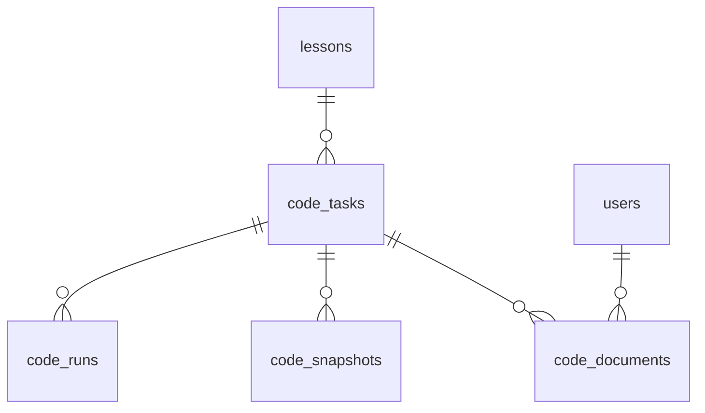

# F-10 プログラミングモード 仕様（v1）

> 位置づけ：拡張機能（発表の目玉候補）。MVP の修正と並行して着手してよい。
> この文書は docs/01・03・04・07 に分けて取り込む前提の「まとめ書き」。取り込み後はこの文書を正とせず各設計書を正とする。
> 決定日：2026-10-31（トーンさん）
> **取り込み済み（2026-10-31・manager）**：docs/01 F-10／docs/03 v4.5／docs/04 v4.5 §7／docs/05 #14〜17／docs/07 §15／docs/08、shared、`server/migrations/003_code_mode.sql`。以後は各設計書を正とする。

---

## 1. 要件（docs/01 に追記する F-10）

### F-10 プログラミングモード

先生が授業中に「プログラミングモード」を起動すると、生徒の視聴画面の映像エリアがコードエディタに切り替わる。生徒はブラウザ上で Java を書き、保存・コンパイル・実行ができる。先生は全生徒のコードを一覧で監視し、エラーのある生徒をその場で把握し、必要なら生徒のエディタを直接編集できる。

- **モード**：授業ごとに `video`（通常）／`coding`。先生が切替。coding 中も生徒カメラは先生に送り続ける（先生は映像グリッド／コードグリッドをタブで切替）
- **課題（task）**：1授業に複数。先生が「タイトル＋テンプレートコード」で追加。先生が「今の課題」を指定すると全生徒のエディタがそのタブに切り替わる。生徒は過去の課題タブに戻れる
- **エディタ**：CodeMirror 6。Java のハイライトと構文解析（Lezer）。構文エラーは打っている最中からリアルタイム検出
- **保存（Ctrl+S / ⌘S / ボタン）**：コードを保存し、同時にコンパイルのみ実行。結果（成功／エラー行・メッセージ）を本人と先生に返す
- **実行（▶ボタン）**：コンパイル＋実行。標準入力欄あり。stdout / stderr / 終了コード / 実行時間を本人と先生に返す
- **制限**：CPU 10 秒、メモリ 256MB、出力 64KB、ネットワーク遮断、同時実行 4 本（超過は待ち行列、「実行待ち N 人」を表示）、1 生徒あたり 1 分に 6 回まで
- **先生の監視**：コードグリッド（生徒ごとにコード先頭 20 行の縮小表示）。状態で枠色を変える：構文エラー＝赤／コンパイルエラー＝赤＋行番号／実行時エラー＝橙／正常終了＝緑チェック／未保存＝グレー
- **先生の編集**：セルをクリックで拡大。拡大中の生徒 1 人のエディタを**直接編集**できる（Yjs による共同編集。生徒側はロックせず打ち続けられる）。生徒画面に「先生が編集中」バッジと先生カーソル（色付き）を表示
- **コードスポットライト**：先生が 1 人のコードを指定すると全員の画面に表示（映像のスポットライトと同じ概念）。解除も先生
- **保存履歴**：保存ごとに履歴を残す。先生が編集して保存した場合は `edited_by_teacher` で区別
- **授業後**：生徒は自分の最終コードをクラス詳細→授業から閲覧・コピーできる。他人のコードは見えない。先生は授業結果画面で課題ごとの「コンパイル成功人数」「保存回数の分布」「最初にコンパイルが通った時刻」を見られる
- **対応言語**：`java` のみ（`language` 欄は持つ）。ファイルは `Main.java` 1 本固定、クラス名 `Main` 必須

### スコープ外
複数ファイル・パッケージ・外部ライブラリ／デバッガ／Java 以外／生徒同士の共同編集／自動採点（S-02 と合体させる案は将来）

### 非機能
- 生徒のコードは**アプリサーバー上で実行しない**。必ず隔離された実行サーバー（Piston）に転送する
- 実行サーバーが落ちてもエディタ・保存・先生の監視は動き続ける（実行だけ「接続できません」）
- Yjs の同期サーバー（y-websocket）はアプリサーバーに同居。接続時にセッション・クラス所属・課題の存在を検証し、不正なら切断

---

## 2. DB（docs/03 に追記）

### lessons（既存に 3 列追加）
| カラム | 型 | 説明 |
|---|---|---|
| mode | ENUM('video','coding') NOT NULL DEFAULT 'video' | 現在のモード |
| active_task_id | INT NULL FK(code_tasks) | 先生が指定した「今の課題」 |
| code_spotlight_user_id | INT NULL FK(users) | コードスポットライト中の生徒。NULL で解除 |

### code_tasks（課題）
| カラム | 型 | 説明 |
|---|---|---|
| id | INT PK | |
| lesson_id | INT FK NOT NULL | |
| title | VARCHAR(100) NOT NULL | 例「課題1 FizzBuzz」 |
| language | ENUM('java') NOT NULL DEFAULT 'java' | |
| template | TEXT NOT NULL | 初期コード。空なら既定の Main 雛形 |
| sort_order | INT NOT NULL | 表示順 |
| created_at | DATETIME NOT NULL | |

### code_documents（生徒×課題のコード本体）
| カラム | 型 | 説明 |
|---|---|---|
| task_id / user_id | INT FK, 複合PK | |
| source | MEDIUMTEXT NOT NULL | 現在のコード（Yjs の永続化先。Yjs の更新を 5 秒おき＋保存時に書き戻す） |
| ydoc_state | MEDIUMBLOB NULL | Yjs のバイナリ状態（再接続時の復元用） |
| updated_at | DATETIME NOT NULL | |

### code_snapshots（保存履歴）
| カラム | 型 | 説明 |
|---|---|---|
| id | BIGINT PK | |
| task_id / user_id | INT FK | |
| source | MEDIUMTEXT NOT NULL | 保存時点のコード |
| compile_ok | BOOL NOT NULL | 保存時のコンパイル結果 |
| edited_by_teacher | BOOL NOT NULL DEFAULT 0 | 先生が編集して保存した |
| saved_at | DATETIME NOT NULL | INDEX(task_id, user_id, saved_at) |

### code_runs（コンパイル・実行ログ）
| カラム | 型 | 説明 |
|---|---|---|
| id | BIGINT PK | |
| task_id / user_id | INT FK | |
| kind | ENUM('compile','run') NOT NULL | |
| status | ENUM('ok','compile_error','runtime_error','timeout','runner_unavailable') NOT NULL | |
| stdout / stderr | TEXT NULL | 64KB で切り詰め |
| exit_code | INT NULL | |
| duration_ms | INT NULL | |
| created_at | DATETIME NOT NULL | INDEX(task_id, user_id, created_at) |

> マイグレーション `003_code_mode.sql`。実行はトーンさんのみ。
> 授業・クラス削除時は CASCADE。コード本体は個人情報に準じて扱い、クラス削除で消える。

---

## 3. API・イベント（docs/04 に章を追加）

### 3.1 REST

| メソッド | パス | ロール | 説明 |
|---|---|---|---|
| PUT | /api/lessons/:id/mode | 先生 | `{mode:"video"\|"coding"}` → 全員に `lesson:mode`。live 中のみ（それ以外 409） |
| POST | /api/lessons/:id/code/tasks | 先生 | `{title, template?, language?:"java"}` → `{task}`。初回作成時は自動で active に。全員に `code:task_added` |
| GET | /api/lessons/:id/code/tasks | 全員 | 課題一覧 `[{id,title,language,sort_order,is_active}]` |
| PATCH | /api/code/tasks/:task_id | 先生 | `{title?, template?}`。テンプレート変更は既存コードに影響しない |
| PUT | /api/lessons/:id/code/active-task | 先生 | `{task_id}` → 全員に `code:active_task` |
| POST | /api/code/tasks/:task_id/redistribute | 先生 | テンプレートを全生徒の該当課題に上書き配布（確認済み前提）→ 対象者に `code:reset` |
| GET | /api/code/tasks/:task_id/documents | 先生 | 全生徒の現在コードと最新状態 `[{user, source_head(20行), state, last_saved_at, last_run_status}]`。グリッド初期表示用 |
| GET | /api/code/tasks/:task_id/documents/:user_id | 先生・本人 | コード全文＋直近の runs 5 件 |
| POST | /api/code/tasks/:task_id/save | 生徒・先生(※) | `{source, edited_by_teacher?:bool, target_user_id?}` → 保存＋コンパイル → `{snapshot_id, compile:{status, errors:[{line,col,message}]}}`。先生が生徒のコードを保存する時は `target_user_id` 必須 |
| POST | /api/code/tasks/:task_id/run | 生徒 | `{source, stdin?}` → 待ち行列に投入 → `{run_id, queued_position}`。結果は `code:run_result` で配信。レート超過は 429 `RATE_LIMITED` |
| PUT | /api/lessons/:id/code/spotlight | 先生 | `{user_id\|null}` → 全員に `code:spotlight` |
| GET | /api/lessons/:id/code/summary | 先生 | 結果画面用。課題ごと `{task, compiled_ok_count, total, saves_histogram, first_ok_at_by_user:[...]}` |
| GET | /api/lessons/:id/code/mine | 生徒 | 授業後の自分のコード `[{task, source, last_saved_at}]` |

エラーコード追加：`RATE_LIMITED`（429）、`RUNNER_UNAVAILABLE`（503）、`NOT_CODING_MODE`（409）

### 3.2 Socket.IO

| イベント | ペイロード | 宛先 | 説明 |
|---|---|---|---|
| `lesson:mode` | `{mode}` | 全員 | モード切替 |
| `code:task_added` | `{task}` | 全員 | 課題追加（生徒側にタブが生える） |
| `code:active_task` | `{task_id}` | 全員 | 今の課題の切替 |
| `code:reset` | `{task_id}` | 対象生徒 | テンプレート再配布（エディタ内容を置換） |
| `code:status` | `{task_id, user_id, state:"idle"\|"syntax_error"\|"compile_error"\|"runtime_error"\|"ok"\|"running", line?}` | 先生 | グリッドの枠色更新。構文エラーは生徒クライアントが検出して送る（下記 C→S） |
| `code:run_result` | `{run_id, task_id, user_id, kind, status, stdout, stderr, exit_code, duration_ms}` | 本人＋先生 | コンパイル／実行結果 |
| `code:queue` | `{position}` | 本人 | 待ち行列の順番更新 |
| `code:spotlight` | `{user_id\|null, task_id}` | 全員 | コードスポットライト |
| `code:teacher_editing` | `{task_id, user_id, editing:bool}` | 対象生徒 | 先生が拡大表示して編集を始めた／やめた |

クライアント→サーバー：
| イベント | ペイロード | 説明 |
|---|---|---|
| `code:syntax` | `{task_id, has_error, line?}` | 生徒クライアントの Lezer 解析結果。変化時のみ送る（連打しない、500ms デバウンス） |

### 3.3 Yjs 同期（Socket.IO とは別の WebSocket）

- エンドポイント：`wss://<app>/yjs/<task_id>/<user_id>`
- 接続時：セッション Cookie でユーザー確認。`user_id` が本人、または先生（授業の teacher_id）のみ許可。それ以外は即切断
- サーバー：`y-websocket` をアプリに同居。Doc の更新を 5 秒おきと `save` 時に `code_documents.source / ydoc_state` へ書き戻す
- awareness で先生カーソルを配信（名前・色）
- 先生が接続したら `code:teacher_editing {editing:true}`、切断で `false`

### 3.4 実行サーバー連携（サーバー内部）

- `CODE_RUNNER_URL`（.env）。開発：`https://emkc.org/api/v2/piston`、本番：VPS 上の Piston
- コンパイルのみ：Piston は compile+run 一体なので、`run` 段階を空にするため `javac` 相当の判定は **stderr に `error:` を含むか・compile 段階の exit code** で判断する。実行時に `main` を呼ばせない方法として、保存時は `Main.java` に加えて実行を即終了させるラッパーを渡す（実装詳細は W2 に委ねるが、仕様としては「保存＝コンパイル結果のみ返す」）
- 待ち行列：アプリ内メモリ（授業ごと）。同時 4、FIFO。サーバー再起動で消えてよい
- レート制限：ユーザー×課題で 1 分 6 回。超過は 429
- タイムアウト：Piston への HTTP 15 秒。超えたら `runner_unavailable`

---

## 4. 画面（docs/07 に追記）

### 4.1 生徒画面（coding モード）
- 映像エリア → エディタに置換。先生映像は右上 PiP（既存の自分カメラ小窓は左下に移動）
- 上部：課題タブ（先生が追加した順）。アクティブ課題は強調。先生が切り替えると自動でそのタブへ（手動で他タブも見られる）
- エディタ：行番号、Java ハイライト、構文エラーの波線、Ctrl+S で保存
- 下部：「▶ 実行」ボタン、stdin 入力欄（折りたたみ）、出力パネル（stdout / stderr タブ、終了コード、実行時間）、「実行待ち N 人」表示
- バッジ：「先生が編集中」（code:teacher_editing）、先生カーソル（色付き・名前）
- コードスポットライト受信時：自分のエディタの上に「〇〇さんのコード」を読み取り専用で表示（閉じるボタンなし。先生が解除するまで）
- スマホ：エディタは横スクロール可、実行ボタンは下部固定。編集はできるが「PC 推奨」のトーストを 1 回出す

### 4.2 先生画面（coding モード）
- ヘッダーにモード切替トグル（video / coding）。coding 起動時にダイアログ：課題1 のタイトルとテンプレート（空なら既定雛形）
- 生徒グリッドに「映像／コード」タブ。コードグリッド：生徒ごとにコード先頭 20 行の縮小＋枠色＋最終保存時刻
- 課題タブ（先生用）：追加「＋」、アクティブ切替、テンプレート編集、「全員に再配布」（確認ダイアログ）
- セルクリック → 拡大パネル：その生徒のエディタ（編集可・Yjs）、出力パネル、runs 履歴 5 件、「この生徒を全員に表示」（コードスポットライト）、「保存（先生として）」
- 枠色の凡例を表示

### 4.3 授業結果画面（追加セクション）
- 課題ごと：コンパイル成功人数／全体、保存回数のヒストグラム、生徒ごとの「最初にコンパイルが通った時刻」「最終状態」「先生編集あり」
- 生徒側クラス詳細→授業：自分のコード（課題ごと）閲覧・コピー

### 4.4 画面一覧への追加
| パス | 画面 | 備考 |
|---|---|---|
| /lessons/:id/learn（coding 時） | 生徒コードエディタ | 既存画面の状態分岐 |
| /lessons/:id/teach（coding 時） | 先生コードグリッド・拡大パネル | 既存画面の状態分岐 |
| /lessons/:id/code/mine | 生徒：自分のコード（授業後） | 新規 |

---

## 5. 実装計画と担当

| 段階 | 内容 | 担当 | 完了条件 |
|---|---|---|---|
| **0** | この仕様を docs/01・03・04・07 に取り込み、shared に型・イベント名・エラーコード追加、`003_code_mode.sql` | manager / トーンさん（migrate） | 契約確定 |
| **1** | モード切替・課題 CRUD・save/run API・待ち行列・レート制限・Piston 連携（公開 API）・Socket 配信 | W2（実行・配信）、W1（tasks/documents/snapshots の CRUD と summary/mine） | curl で保存→コンパイルエラーが返る、実行→Hello が返る |
| **1** | 生徒エディタ（CodeMirror 6 + lang-java）、課題タブ、保存・実行・出力、構文エラー送信 | W4 | 生徒が書いて実行できる |
| **1** | 先生コードグリッド（読み取り）、枠色、拡大パネル（読み取り）、モード切替、課題タブ | W5 | 先生が全員のコードとエラーを見られる |
| **2** | Yjs：y-websocket サーバー同居、認証、永続化 | W2 | 先生と生徒が同じ文書を同時編集できる |
| **2** | 拡大パネルを編集可能に、先生カーソル、teacher_editing バッジ、コードスポットライト、再配布 | W5 / W4 | 先生がその場で直せる |
| **3** | VPS に Piston セルフホスト、`CODE_RUNNER_URL` 切替、負荷確認（30 人同時実行） | W3 | 公開 API なしで動く |
| **3** | 授業結果のコードセクション、生徒の授業後閲覧 | W5 / W4 | |

**段階 1 が終われば発表で使える。** 段階 2 は「できたら目玉」、段階 3 は本番の安定性。

### ファイル所有権（追加分）
| ワーカー | 編集してよい場所 |
|---|---|
| W1 | `server/src/routes/code-tasks.js`, `server/src/services/code-tasks.js`（tasks / documents / snapshots / summary / mine） |
| W2 | `server/src/routes/code-run.js`, `server/src/services/code-runner.js`（Piston 連携・待ち行列・レート制限）, `server/src/sockets/handlers/code-*.js`, `server/src/yjs/*`（y-websocket） |
| W3 | `infra/vps/piston/*`, `docs/infra/piston-setup.md` |
| W4 | `client/src/components/learn/code/*`（CodeEditor, TaskTabs, RunPanel, OutputPanel）, LearnPage の coding 分岐, `/code/mine` 画面 |
| W5 | `client/src/components/teach/code/*`（CodeGrid, CodeCell, CodeInspector, TaskManager）, TeachPage の coding 分岐, 結果画面のコードセクション |
| 共通 | `client/src/lib/yjs-provider.js`（W2 が書いて W4/W5 が使う。props は docs/requests/code-yjs.md で合意） |

### 依存ライブラリ（追加）
- client：`@codemirror/state`, `@codemirror/view`, `@codemirror/lang-java`, `codemirror`, `yjs`, `y-codemirror.next`, `y-websocket`
- server：`yjs`, `y-websocket`（or `y-socket.io`）, `ws`

---

## 6. 実行サーバー（Piston）メモ — W3 向け

- 開発：`https://emkc.org/api/v2/piston/execute` に `{language:"java", version:"*", files:[{name:"Main.java", content}], stdin, run_timeout: 10000, compile_timeout: 10000}` を POST。秒 5 リクエスト制限
- 本番：VPS で `docker run -d --name piston --privileged -p 2000:2000 -v piston:/piston ghcr.io/engineer-man/piston` → `cli/ppman install java` で Java ランタイム導入。アプリからは `http://<VPS内部 or 限定公開>:2000/api/v2/execute`。**ポート 2000 は Railway のアプリサーバーからのみ到達できるようファイアウォールで限定**（公開しない）
- Piston 側の制限（`PISTON_MAX_PROCESS_COUNT`, `PISTON_OUTPUT_MAX_SIZE`, メモリ）を仕様の値に合わせる
- 同居する LiveKit とポート競合なし（LiveKit は 443/7881/UDP）
- 死活監視：アプリ起動時と 1 分おきに `GET /api/v2/runtimes` を叩き、失敗が続けば `runner_unavailable` を返すモードに切替

---

## 7. 発表での見せ方（90 秒）

1. 先生役がプログラミングモードを起動、「課題1：Hello」のテンプレートを配布（会場の人のスマホ／PC のエディタに雛形が出る）
2. 会場の人に `System.out.println("Hello")` の `;` を抜いて Ctrl+S してもらう → 先生画面のその人のセルが赤枠に
3. 先生役がセルを拡大 → その場で `;` を打つ（会場の人の画面で先生カーソルが動いて直るのが見える）
4. 会場の人が ▶ 実行 → Hello が出る → セルが緑に
5. 「全員に表示」で正解コードをスポットライト

---

## 8. リスク（リスク管理表に追加）

| # | リスク | 対策 |
|---|---|---|
| 14 | 生徒コードの任意実行によるサーバー侵害 | アプリサーバーでは絶対に実行しない。Piston の隔離＋ネット遮断＋資源制限。Piston のポートはアプリからのみ到達可 |
| 15 | Piston 公開 API のレート制限で授業中に詰まる | 本番は VPS セルフホスト。待ち行列と「実行待ち N 人」表示 |
| 16 | Yjs の同期不整合・接続切れでコードが消える | 5 秒おき永続化、保存時にスナップショット。再接続時は `ydoc_state` から復元 |
| 17 | スマホでのエディタ操作性 | 「PC 推奨」表示。編集はできるが主対象は PC |
